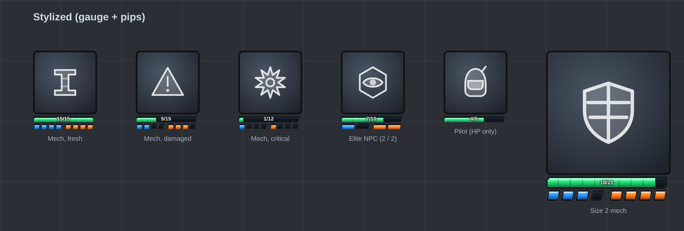

# LANCER HUD for Bar Brawl

A stylized token HUD for the LANCER system, built on [Bar Brawl](https://foundryvtt.com/packages/barbrawl). Every mech and NPC token shows:

- **HP**: a LANCER-style gauge with the current/max value on it.
- **Structure**: blue pips, one per point of maximum Structure.
- **Stress**: orange pips, one per point of maximum Stress.



Pilots and deployables get the HP gauge only (they have no Structure or Stress). Pip art always matches the actor's maximum (1–8 pips; a continuous gauge above 8) and updates by itself when a frame or NPC tier changes it.

## Install

Requires the **Bar Brawl** module and the **LANCER** system. Foundry v12 or v13.

Manifest URL (Foundry: *Add-on Modules → Install Module*; The Forge: *The Bazaar → Install From Manifest*):

```
https://raw.githubusercontent.com/Jayty07/Lancer-Skill-Trees/main/bar-brawl-hud/module.json
```

Enable **Bar Brawl** and **LANCER HUD for Bar Brawl** in your world. Then, as GM, open **Settings → Configure Settings → LANCER HUD for Bar Brawl → Apply to all actors and tokens**. New tokens get the HUD automatically.

## Settings

| Setting | Default | |
|---|---|---|
| HUD style | Stylized | *Stylized*: gauge and pip art. *Clean*: Bar Brawl's colored bars with HP / STRUCTURE / STRESS labels. |
| Position | Below the token | Below, over the bottom of, or above the token. |
| Other players see bars | On hover | For tokens a player doesn't own. Owners and the GM always see their bars. |
| Keep other Bar Brawl bars | Off | On: keeps bars you added (Heat, Overshield…). Off: the HUD replaces all Bar Brawl bars on a token. |
| Apply to new tokens | On | Tokens that already have custom Bar Brawl bars are left alone. |

Changing the style, position or visibility offers to re-apply the HUD everywhere.

The bars are ordinary Bar Brawl bars (ids `lhud-hp`, `lhud-structure`, `lhud-stress`), so you can still tweak any token in *Token Configuration → Resources*, and edit values from the token HUD.

## Macro API

```js
const hud = game.modules.get("lancer-barbrawl-hud").api;
await hud.applyEverywhere();            // same as the settings button
await hud.applyToToken(token.document); // one token
await hud.applyToActor(actor);          // one actor's prototype token
```

LANCER is copyright Massif Press. This is an unofficial third-party work, not affiliated with Massif Press.
